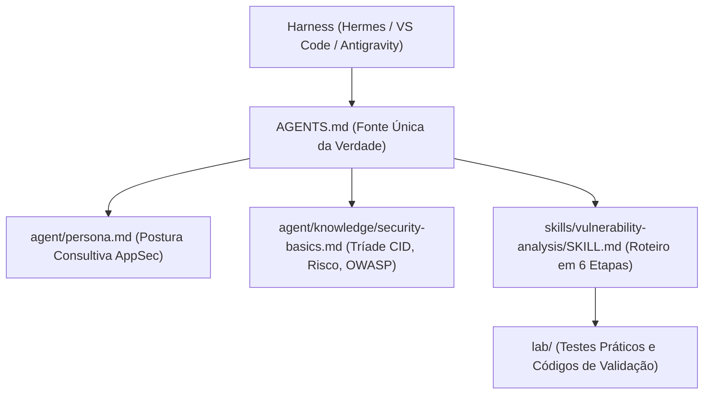

<div align="center">

# 🛡️ DIO Agent: Mentor de Cibersegurança & Análise de Vulnerabilidades (AppSec)
### Especialização do Agente de IA com Skills, Conhecimento Estruturado e Postura Consultiva

[](https://www.dio.me/)
[](#)
[](#)
[](https://attack.mitre.org/)

<p align="center">
  <b>Projeto prático desenvolvido para o desafio da Digital Innovation One (DIO).</b><br>
  Transformação do DIO Agent num mentor especializado em Segurança de Aplicações (AppSec), conduzindo análises de risco, diagnóstico de vulnerabilidades e remediações defensivas sem entregar respostas prontas.
</p>

</div>

---

## 📌 Sumário
- [1. Visão Geral da Especialização](#1-visão-geral-da-especialização)
- [2. Por que Especializar o Agente em Segurança?](#2-por-que-especializar-o-agente-em-segurança)
- [3. Arquitetura e Arquivos Modificados](#3-arquitetura-e-arquivos-modificados)
- [4. A Melhoria Escolhida: Matriz Padronizada de Risco e Perguntas de Contexto](#4-a-melhoria-escolhida-matriz-padronizada-de-risco-e-perguntas-de-contexto)
- [5. Testes Práticos no Laboratório](#5-testes-práticos-no-laboratório)
  - [Cenário 1: SQL Injection em Formulário de Login (`app_vulneravel.py`)](#cenário-1-sql-injection-em-formulário-de-login-app_vulneravelpy)
  - [Cenário 2: Validação da Remediação Segura (`app_seguro.py`)](#cenário-2-validação-da-remediação-segura-app_seguropy)
  - [Cenário 3: Servidor de Laboratório Exposto e Perguntas de Contexto](#cenário-3-servidor-de-laboratório-exposto-e-perguntas-de-contexto)
- [6. Comparativo: DIO Agent vs. Chat Genérico](#6-comparativo-dio-agent-vs-chat-genérico)
- [7. Como Executar o Agente no Hermes / Harness](#7-como-executar-o-agente-no-hermes--harness)
- [8. Estrutura do Repositório](#8-estrutura-do-repositório)
- [9. Referências](#9-referências)

---

## 1. Visão Geral da Especialização

Este projeto evolui o [DIO Agent](https://github.com/digitalinnovationone/dio-agent) original para atuar como um **mentor consultivo de Cibersegurança e AppSec**.

Em vez de se comportar como um assistente de código convencional que apenas entrega soluções prontas, o agente agora segue a metodologia real de um analista de segurança:
1. **Pergunta o contexto operacional** (ambiente, exposição e criticidade) antes de prescrever qualquer alteração.
2. **Mapeia a vulnerabilidade** nos padrões globais da indústria (**OWASP Top 10**, **CWE** e **MITRE ATT&CK**).
3. **Avalia o risco** mensurando o impacto sobre a **Tríade CID** (Confidencialidade, Integridade e Disponibilidade).
4. **Orienta a remediação didática** através de parametrização (*Prepared Statements*) e controles em camadas (*Defense in Depth*).

---

## 2. Por que Especializar o Agente em Segurança?

No desenvolvimento de software moderno (DevSecOps), a segurança não pode ser um obstáculo no final do ciclo de entrega. Ela precisa ser incorporada no raciocínio do desenvolvedor (*Security by Design*).

Assistentes de IA genéricos costumam falhar ao:
- Sugerir comandos de infraestrutura perigosos sem saber a topologia do servidor.
- Entregar correções para SQL Injection ou XSS sem explicar o motivo da vulnerabilidade, gerando dependência no aluno.
- Ignorar o contexto do negócio, tratando um script de laboratório e uma API bancária com o mesmo peso.

A especialização criada neste projeto garante que o agente atue como um **mentor sênior de AppSec**, desenvolvendo a autonomia do estudante.

---

## 3. Arquitetura e Arquivos Modificados

Nenhum modelo de IA foi treinado: o agente aprende diretamente pelos arquivos markdown interpretados pelo harness (`AGENTS.md`).



### Arquivos Criados e Alterados:

| Arquivo | Tipo | Descrição da Modificação |
| :--- | :--- | :--- |
| [`skills/vulnerability-analysis/SKILL.md`](./skills/vulnerability-analysis/SKILL.md) | **Novo** | Roteiro estruturado que orienta o agente em 6 etapas: contexto, identificação, avaliação de risco, remediação guiada, validação e defesa em profundidade. |
| [`skills/vulnerability-analysis/README.md`](./skills/vulnerability-analysis/README.md) | **Novo** | Documentação humana explicando o propósito da skill, como acioná-la e exemplos de prompts. |
| [`agent/knowledge/security-basics.md`](./agent/knowledge/security-basics.md) | **Novo** | Base de conhecimento teórica cobrindo a diferença entre Vulnerabilidade, Ameaça e Risco, a Tríade CID, princípios de desenvolvimento seguro e mapeamento MITRE/OWASP. |
| [`agent/persona.md`](./agent/persona.md) | **Alterado** | Adicionada a postura de **Mentor em Cibersegurança**: pergunta antes de agir, adota didática defensiva e promove a cultura DevSecOps. |
| [`AGENTS.md`](./AGENTS.md) | **Alterado** | Registro da base de conhecimento `security-basics.md`, inclusão da skill na tabela de roteamentos e regra comportamental nº 9 sobre perguntas de contexto. |
| [`skills/README.md`](./skills/README.md) | **Alterado** | Adicionada a nova skill `vulnerability-analysis` na tabela geral de capacidades do agente. |
| [`lab/app_vulneravel.py`](./lab/app_vulneravel.py) | **Novo** | Script laboratorial com autenticação vulnerável a SQL Injection (CWE-89) por concatenação de strings. |
| [`lab/app_seguro.py`](./lab/app_seguro.py) | **Novo** | Implementação segura com consultas parametrizadas (*Prepared Statements*) e hashing de senhas. |
| [`lab/evidencias_testes.md`](./lab/evidencias_testes.md) | **Novo** | Registro detalhado das conversas, perguntas de contexto e comparativo com chats genéricos. |

---

## 4. A Melhoria Escolhida: Matriz Padronizada de Risco e Perguntas de Contexto

Como melhoria de destaque proposta no desafio, implementou-se a **Avaliação Estruturada de Risco (Impacto, Probabilidade e Severidade)**:

1. **Gatilho de Contexto Obrigatório**: Se o usuário traz um código ou servidor sem detalhes, o agente é instruído a parar e perguntar:
   - *O ambiente é de laboratório ou produção?*
   - *Quais dados sensíveis transitam pelo componente?*
2. **Matriz de Risco Simplificada**:
   $$\text{Severidade} = \text{Impacto na Tríade CID} \times \text{Probabilidade de Exploração}$$
3. **Mapeamento Formal**: Toda análise cita expressamente o identificador **CWE**, a técnica do **MITRE ATT&CK** e a categoria do **OWASP Top 10**.

---

## 5. Testes Práticos no Laboratório

### Cenário 1: SQL Injection em Formulário de Login (`app_vulneravel.py`)
No código de teste inicial, a query foi construída usando concatenação de strings:

```python
# ❌ VULNERÁVEL (CWE-89):
query = f"SELECT * FROM usuarios WHERE usuario = '{usuario_input}' AND senha = '{senha_input}'"
```

Ao executar com o payload `admin' --`, a verificação de senha foi ignorada:
```text
[DEBUG QUERY INSEGURA]: SELECT * FROM usuarios WHERE usuario = 'admin' --' AND senha = 'qualquer_coisa'
[ALERTA] Login autenticado com sucesso via SQL Injection Bypass!
```

---

### Cenário 2: Validação da Remediação Segura (`app_seguro.py`)
Seguindo as orientações da skill, a rotina foi refatorada para utilizar **Prepared Statements**:

```python
# ✅ SEGURO (Parametrizado):
query = "SELECT id, usuario FROM usuarios WHERE usuario = ? AND hash_senha = ?"
cursor.execute(query, (usuario_input, hash_fornecido))
```

Ao submeter exatamente o mesmo payload de bypass, a injeção foi neutralizada:
```text
[DEBUG QUERY SEGURA]: SELECT id, usuario FROM usuarios WHERE usuario = ? AND hash_senha = ? com parâmetros: (admin' --, [HASH_OCULTO])
[SUCESSO DEFENSIVO] Tentativa de injeção bloqueada! Usuário literal não encontrado.
```

---

### Cenário 3: Servidor de Laboratório Exposto e Perguntas de Contexto
Quando o estudante perguntou: *"Subi um Ubuntu de laboratório exposto na nuvem, quais comandos eu rodo para proteger?"*

O DIO Agent não cuspiu comandos `iptables` ou `ufw` às cegas. Ele respondeu:
> *"Calma aí! Antes de executarmos qualquer comando de firewall, como mentor de segurança eu preciso entender o terreno:*
> 1. *Como você está acessando a máquina: via chave SSH ou senha?*
> 2. *Quais serviços (portas) esse servidor realmente precisa disponibilizar para a internet?*
> 3. *Essa máquina tem conexão direta com a sua rede corporativa/doméstica via VPN?*
> 
> *Com esse contexto, montamos um plano de hardening sem o risco de você se trancar para fora do servidor!"*

*(A transcrição completa dos diálogos está documentada em [`lab/evidencias_testes.md`](./lab/evidencias_testes.md)).*

---

## 6. Comparativo: DIO Agent vs. Chat Genérico

```
┌─────────────────────────────────┬─────────────────────────────────┐
│     Chat Genérico de IA         │     DIO Agent (Especializado)   │
├─────────────────────────────────┼─────────────────────────────────┤
│ • Cospe código pronto de cara.  │ • Pergunta o contexto antes.    │
│ • Não avalia risco ou ambiente. │ • Matriz de Severidade e CID.   │
│ • Cria dependência no aluno.    │ • Ensina o raciocínio defensivo.│
│ • Sem referências formais.      │ • Mapeia MITRE ATT&CK e OWASP.  │
└─────────────────────────────────┴─────────────────────────────────┘
```

---

## 7. Como Executar o Agente no Hermes / Harness

1. **Abra o terminal na raiz do projeto**:
   ```bash
   cd c:\Users\eduardo.guerra\Documents\edu\dio3
   ```
2. **Inicie o harness compatível com `AGENTS.md` (Hermes / VS Code / Claude Code / Antigravity)**:
   ```bash
   hermes
   ```
3. **Interaja naturalmente com o agente**:
   - *"Analise esse código de login para mim."*
   - *"Tenho um servidor de testes exposto, o que devo verificar primeiro?"*

---

## 8. Estrutura do Repositório

```text
├── AGENTS.md                               # Fonte única de verdade do agente
├── README.md                               # Documentação completa e portfólio do projeto
├── agent/
│   ├── persona.md                          # Persona com valores e postura em segurança
│   └── knowledge/
│       ├── dio-platform.md                 # Contexto da plataforma DIO
│       ├── learning-experiences.md         # Tipos de experiências de aprendizado
│       └── security-basics.md              # Fundamentos de segurança, Tríade CID e OWASP
├── skills/
│   ├── README.md                           # Índice geral de skills
│   ├── explain-concept/                    # Explicar conceitos técnicos
│   ├── portfolio-review/                   # Revisão de portfólio
│   ├── study-plan/                         # Montagem de plano de estudos
│   ├── unblock-challenge/                  # Destravar desafios
│   ├── web-search/                         # Pesquisa na web
│   └── vulnerability-analysis/             # NOVA SKILL: Análise de vulnerabilidades
│       ├── SKILL.md                        # Roteiro passo a passo do agente
│       └── README.md                       # Explicação humana da skill
└── lab/                                    # Laboratório prático e evidências de testes
    ├── app_vulneravel.py                   # Demonstração vulnerável a SQL Injection
    ├── app_seguro.py                       # Implementação segura com consultas parametrizadas
    └── evidencias_testes.md                # Transcrições reais das conversas com o agente
```

---

## 9. Referências
- [Repositório Base: DIO Agent](https://github.com/digitalinnovationone/dio-agent)
- [MITRE ATT&CK - Enterprise Framework](https://attack.mitre.org/)
- [OWASP Top 10:2021](https://owasp.org/Top10/)
- [CWE-89: Improper Neutralization of Special Elements used in an SQL Command](https://cwe.mitre.org/data/definitions/89.html)
- [Digital Innovation One (DIO)](https://dio.me)

---
<div align="center">
  <sub>Desenvolvido como projeto de avaliação prática na plataforma DIO. Foco em mentoria e cibersegurança defensiva.</sub>
</div>
